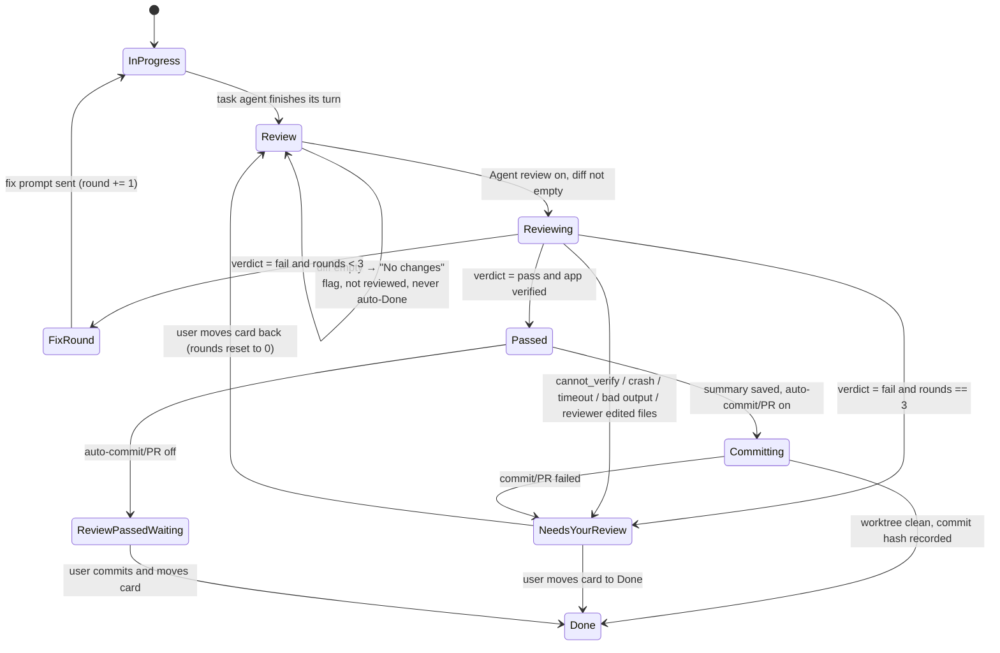

# Agent review — design spec

Date: 2026-10-28
Status: draft for the user to approve
Scope: design only. No code is part of this document.

Labels used below:

- **[user]**: the user decided this. Do not change it without asking.
- **[assistant's call, user may revise]**: the assistant decided this while writing the spec. Build it this way unless the user says otherwise.
- **[builder]**: left to the builder on purpose.

---

## 1. Intent

The user does not want to review every task by hand. Today, when a task reaches **Review**, they read the diff, run the tests and check that the app still runs. Then they commit (or let auto-commit do it) and move the card to **Done**.

Recently task `2483d` reached Done without any real fix. Nothing stopped it. That must not happen again.

**Agent review** puts a Kanban-run reviewer agent in that seat. When a task reaches Review, the reviewer:

1. reads the diff,
2. runs the tests,
3. checks that the app actually runs, and
4. compares the result with the task's original prompt.

If the task is good, it goes to Done with a plain-language summary on the card. If it is not good, the reviewer tells the task's own agent what to fix. After a limited number of rounds, the task goes to a new column where the user takes over.

## 2. Goals, non-goals, anti-goals

### Goals

- G1. Every task with Agent review on is reviewed automatically when it reaches Review, with no click from the user.
- G2. A failed review turns into a concrete fix prompt sent to the task's own agent session. The task agent fixes it and the task is reviewed again.
- G3. Review is bounded. After 3 fix rounds the task goes to **Needs your review**. **[user]**
- G4. A task that passes ends in Done with a human-readable summary. The user should not need to open the diff.
- G5. Review runs in the Kanban runtime (server side). It keeps going when every browser tab and the desktop window are closed. **[user]**
- G6. The user can choose the reviewer agent in settings. **[user]**

### Non-goals

- The reviewer does not fix code itself. **[user]**
- Not a replacement for CI, and no new test framework. The reviewer uses whatever the project already has.
- No change to how tasks without Agent review behave. Existing auto-commit / auto-PR keeps working as it does today.
- No multi-reviewer voting, and no reviewing of tasks in Backlog or In Progress.
- No moving the board automation for **normal** tasks (column auto-moves, auto-commit) to the runtime. For tasks with Agent review on, the runtime owns all of it (see 5.1).

### Anti-goals (count as failure even if the feature "works")

- A1. The reviewer changes files in the task worktree.
- A2. A task reaches Done with no changes, or with the requested work not done.
- A3. A review session hangs forever, or review/fix keeps looping past the round limit.
- A4. Review stops without telling anyone because the UI is closed.

## 3. How things work today (grounding)

These facts come from the code and limit the design.

- **Columns.** `src/core/api-contract.ts` defines `runtimeBoardColumnIdEnum = ["backlog", "in_progress", "review", "trash"]`. `"trash"` is shown as **Done** (`src/state/workspace-state.ts`, `BOARD_COLUMNS`). Saved boards using `"done"` are already mapped to `"trash"` by a `z.preprocess`.
- **Card schema.** `runtimeBoardCardSchema` has `prompt`, `title`, `images`, `agentId` (optional), `baseRef`, `startInPlanMode`, `autoReviewEnabled`, `autoReviewMode` (`"commit" | "pr"`), plus Cline settings. Agent ids are `claude, codex, gemini, opencode, droid, kiro, cline`.
- **Who moves cards today.** The **browser** moves cards. `web-ui/src/hooks/use-board-interactions.ts` watches session summaries:
  - `awaiting_review` while in `in_progress` → move to `review`.
  - `running` while in `review` → move back to `in_progress`.
  - `interrupted` → move to `trash`.

  The runtime does not change `board.json` for these moves. `src/server/workspace-registry.ts` only *projects* the counts.
- **Auto-commit / auto-PR is browser-only.** `web-ui/src/hooks/use-review-auto-actions.ts`: when a card in Review has `autoReviewEnabled` and `changedFiles > 0`, it waits 500 ms, then calls `runAutoReviewGitAction`. That builds a prompt with `buildTaskGitActionPrompt` (templates `commitPromptTemplate` / `openPrPromptTemplate` from runtime config, `{{base_ref}}` variable). The prompt is sent to the task session. Once "armed", a later Review state with `changedFiles === 0` counts as success and the card moves to Done. Review entries with zero changes are ignored on purpose (plan-mode loops). With no browser open, none of this runs.
- **How a prompt reaches the task agent.** `web-ui/src/hooks/use-git-actions.ts`:
  - PTY agents: `sendTaskSessionInput(taskId, prompt, { mode: "paste" })` (an xterm bracketed paste done **in the browser**), wait 200 ms, then send `"\r"`.
  - Cline: `sendTaskChatMessage(taskId, prompt, { mode: "act" })`.

  On the runtime side, `sendTaskSessionInput` in `src/trpc/runtime-api.ts` tries the Cline service first, then `TerminalSessionManager.writeInput`. It returns `"Task session is not running."` when there is no live process. A runtime-side sender has no xterm, so it has to write the bracketed-paste escape sequences (`ESC[200~` … `ESC[201~`) itself, or use another submit method the agent accepts.
- **Session states.** `src/terminal/session-state-machine.ts`: `hook.to_review` moves `running → awaiting_review` with `reviewReason: "hook"`. This **same reason** is used for a finished turn (Claude `Stop`, Cline `TaskComplete`) and for "agent is waiting for the user" (Claude `PermissionRequest` / `Notification`, Cline `Notification`; see `src/terminal/agent-session-adapters.ts`). `latestHookActivity.hookEventName` / `notificationType` tell them apart. Process exit gives `exit` / `error` / `interrupted`.
- **Session identity.** `TerminalSessionManager.entries` and the Cline task session service are keyed by `taskId`. Only one session per task id is possible.
- **Done = worktree deleted.** Moving to Done stops the task session and deletes the task worktree (browser: `cleanupTaskWorkspace`; CLI: `trashTaskById` in `src/commands/task.ts` → `deleteTaskWorkspace`). Anything that only exists in the worktree is gone after Done.
- **Dependencies.** `getLinkedBacklogTaskIdsReadyAfterTaskTrashed` in `src/core/task-board-mutations.ts` returns linked backlog tasks to auto-start **only when the task moves to trash from `review`**. The CLI then starts them with `startTask`.
- **Board writes.** `board.json` has a revision number (`saveWorkspaceState` with `expectedRevision`; `mutateWorkspaceState` for read-modify-write under a lock). The CLI changes the board on disk and calls `workspace.notifyStateUpdated` so the runtime broadcasts to browsers.
- **Turn checkpoints.** Session summaries have `latestTurnCheckpoint` / `previousTurnCheckpoint` (commit refs per turn). These can help show what changed in the last fix round.

## 4. The decided design

### 4.1 Task flow

In words: **Review → reviewing → (fail → fix prompt → In Progress → Review → reviewing …) → Done | Needs your review.**

`Reviewing`, `FixRound`, `Passed` and `Committing` are **not columns**. They are an agent-review status on the card. The card stays in Review while it is being reviewed or committed, and is in In Progress while the task agent is fixing (the existing "running → in_progress" rule).

### 4.2 Triggering a review

A review starts when **all** of these are true:

- the card has `agentReviewEnabled` on;
- the task session is `awaiting_review` because the agent **finished its turn**: `reviewReason` is `"hook"` with a turn-end hook event (`Stop`, `TaskComplete`, or the agent's equivalent), or `"exit"` with exit code 0. A permission request, a question to the user (`attention`, `PermissionRequest`, `Notification` / `user_attention`), `error` or `interrupted` does **not** start a review. Those behave as they do today. **[assistant's call, user may revise]**
- no review, fix-wait or commit is already running for this task;
- the card is in `in_progress` or `review`. If it is still in `in_progress`, the runtime moves it to `review` itself. It cannot count on a browser being open to do that.

**Empty diff.** The runtime computes the diff against the task's base. If it is empty (no committed, staged, unstaged or untracked-non-ignored changes), it does **not** run the reviewer and does **not** count a round. The card stays in Review with a visible "No changes, not reviewed" flag. It never moves to Done automatically. This keeps the existing plan-mode loop working and stops a repeat of `2483d`. **[assistant's call, user may revise]**

### 4.3 The reviewer session

- **Separate session** in the task's worktree. It is not the task's own session and must not take the task's `taskId` key in `TerminalSessionManager` or the Cline service. **[assistant's call]**
- **Agent choice.** A global setting, `reviewerAgent`, set to `"same_as_task"` (default) or a specific `RuntimeAgentId`. "Same as task" means `card.agentId`, falling back to the runtime's `selectedAgentId`. If the chosen agent is not installed or not configured, the task goes to Needs your review with that reason. **[user]** for the choice; **[assistant's call]** for the fallback.
- **Read-only.** The reviewer may run commands (install, test, build, start the app) but must not change the worktree. See 4.7 for enforcement. The reviewer prompt must tell it to use commands that do not rewrite tracked files: lockfile-respecting installs (`npm ci`, `pnpm install --frozen-lockfile`, etc.), no snapshot-update flags, no formatters or codegen that write tracked files. **[assistant's call]**
- **Shared ignored paths.** Task worktrees symlink the main checkout's gitignored paths (`node_modules`, `.env`, build folders; see `mirrorIgnoredPath` in `src/workspace/task-worktree.ts`). So a reviewer's install or build writes into the shared folders, exactly as task agents already do today. This is accepted. To avoid two reviewers writing the same shared folders at once, the runtime runs **at most one reviewer per workspace at a time**, and other reviews wait in a queue. **[assistant's call]** No isolated copy of the worktree for the reviewer.
- **What the reviewer gets as input:**
  - the task title and original `prompt`, plus the images if the reviewer agent supports images;
  - `baseRef` and how to see the full diff (committed on the task branch since the merge-base, plus working-tree changes);
  - the round number, and for round 2 and later, the earlier fix prompts so it can check those items;
  - its rules: do not edit, verify by running, decide by itself how to run the app (package.json scripts, README, Makefile, etc.), stop anything it started, and give the output in the required format.
- **What it must do:** read the diff, run the project's tests, check the app runs, and compare the result with the prompt.
- **App check rule.** If it cannot get the app to run for reasons outside the task (no run instructions, missing secrets or services), it must report `appVerified: false` with the reason. **That is not a pass.** **[user]** If the app does not run *because of the task's change*, that is a `fail` with a fix prompt.
- **Output is structured.** **[assistant's call]** Exactly one result:
  - `verdict`: `"pass" | "fail" | "cannot_verify"`
  - `appVerified`: boolean, plus `appCheck`: what was run and what happened
  - `tests`: commands run and their results (pass/fail counts or "no tests found")
  - `summary`: the five summary fields from 4.6 (required for `pass`; best effort otherwise)
  - `fixPrompt`: required for `fail`. Concrete, numbered issues, each with what is wrong, where, and how the reviewer will check it next time.
  - `notes`: free text for the user.
- **Pass** means all of these: `verdict === "pass"`, `appVerified === true`, the diff is not empty, and the worktree was not changed by the reviewer. Anything else is not a pass.
- **`cannot_verify`** goes straight to Needs your review. No fix prompt is sent, because the task agent cannot fix an environment problem. **[assistant's call, user may revise]**

### 4.4 Fix rounds

- On `fail`, the runtime sends `fixPrompt` into the **task's own running session**. It uses the same path auto-commit uses: Cline → task chat message in `act` mode; PTY agents → paste the text, then submit. The message starts with a short header so the task agent (and the user reading the terminal) knows it came from the Kanban reviewer, which round it is, and that the task should stop when done.
- **Round counting:** each fix prompt sent counts as 1 round. **[assistant's call, user may revise]** The limit is 3 **[user]**:
  - review 1 fails → fix 1 → review 2 fails → fix 2 → review 3 fails → fix 3 → review 4 fails → **Needs your review**.
  - So the worst case is 4 reviewer runs and 3 fix prompts.
- After the fix prompt, the task session goes `running`, so the card moves to In Progress. When the agent finishes its turn, it comes back to Review and is reviewed again (4.2).
- **The task session is not running** (process exited, send fails, or the runtime restarted and the session was not brought back): for Cline, try `rebindPersistedTaskSession` first, as `sendTaskChatMessage` does. If it still fails, go to Needs your review with reason "task agent not running". Do not start a fresh task session on its own. **[assistant's call]**
- **Counter reset to 0** **[assistant's call, user may revise]** when:
  - the user moves the card out of Needs your review (back to Review or In Progress), or
  - the user sends their own message or keystrokes into the task session. Input sent by the agent-review orchestrator must be tagged so it does not count as user input. If the user sends input while a reviewer run is in progress, that run's result is thrown away (it reviewed a stale state). The task is reviewed again after the user's turn ends.
- **No timeout on the task agent's fix turn.** That is normal task work, visible in In Progress, same as today. Timeouts apply only to reviewer runs and the commit step (4.7). **[assistant's call]**

### 4.5 Pass → summary → commit → Done

Order **[assistant's call, user may revise]**:

1. **Save the summary on the card first** (in `board.json`, via `mutateWorkspaceState`). This must happen before Done, because Done deletes the worktree.
2. **Auto-commit / PR, if the card has `autoReviewEnabled`:**
   - the runtime builds the commit or PR prompt from the same templates as `buildTaskGitActionPrompt` (move or share that function so the runtime and web-ui use one implementation);
   - it sends the prompt, then waits for the task session to finish its turn with a clean worktree (`changedFiles === 0`);
   - success: read `HEAD` of the task branch and record the commit hash (and the PR URL if the agent printed one and it can be found reliably; **[builder]**);
   - the task coming back to Review during this step must **not** start a new review;
   - failure (agent finished but the worktree is still dirty, send failed, or timeout) → Needs your review with reason "commit failed". The summary stays.
3. **Move to Done** using the same Done routine the CLI uses: stop the session, move the card to `trash`, auto-start ready dependents, delete the worktree. The runtime needs this as a shared function. Today it is split between the browser (`requestMoveTaskToTrash` + `cleanupTaskWorkspace`) and the CLI (`trashTaskById`).

**If auto-commit is off when review passes:** the card stays in **Review** with status "Agent review passed" and the summary shown. It does **not** move to Done by itself, because Done would delete uncommitted work. The user commits and moves it, as today. **[assistant's call, user may revise]** See open question Q1.

- **"Passed" is stable.** When a review passes, the runtime stores a fingerprint of the reviewed content: the tree of the task branch plus working changes, compared with the base. A later trigger (4.2) starts a new review only if that fingerprint has changed. So when the user commits the same content with the Commit button, or chats without changing code, the card stays "passed" and is not reviewed again. The same fingerprint rule applies to the "No changes" flag. **[assistant's call]**
- In this state the runtime does not move the card to Done, even after the worktree is clean. The user drags it, as today.

### 4.6 The Done-card summary

Saved on the card. Shown on the Done card and in the task detail view. Content:

- **What was done.** 2–3 plain sentences, not a file list. **[user]**
- **What it affects.** User-visible behavior and the parts of the app touched. **[user]**
- **Against the request.** Anything in the original prompt not done, or done differently. "Nothing" if it all matches.
- **How it was verified.** Test commands and results, and the app check result.
- **Risks / what to check by hand.**
- **Meta.** Commit hash (if committed), number of review rounds, reviewer agent used, time of review.

The reviewer writes the first five fields. The runtime adds Meta.

Tasks that end in Needs your review also show the latest reviewer result (verdict, reason, last fix prompt, the summary if there is one), so the user can see what is still wrong.

### 4.7 Safety rules (anti-goals made concrete)

- **A1, reviewer edits files.** Before and after each reviewer run, the runtime records: `HEAD`, current branch, `git status --porcelain` (tracked + untracked, not ignored) with content hashes of changed/untracked files, and `git stash list`. If anything differs after the run, the result is invalid, **no** fix prompt is sent, and the task goes to Needs your review with reason "reviewer modified the worktree", listing the changed paths. This includes "harmless" changes such as a rewritten lockfile or updated snapshots. The prompt rules in 4.3 exist to avoid them, and the strict check is what protects anti-goal A1. Files in gitignored paths (build output, caches, `node_modules`) may change. **[assistant's call]** The runtime does **not** try to undo the changes automatically. The user decides. **[assistant's call]** If this turns out to send too many good tasks to Needs your review, the next step is an allow-list of paths the runtime may restore; that is not part of v1.
- **A2, Done with nothing done.** Empty diff never triggers a review or an auto-Done (4.2). Pass needs `appVerified` and a non-empty diff (4.3). The comparison with the prompt is a required part of the reviewer's job, and anything left out is shown in "Against the request".
- **A3, hangs / loops.** Every reviewer run has a hard timeout. On timeout the runtime kills the reviewer's whole process tree, including any dev server or test runner it started. The round limit is enforced by the runtime, not by the reviewer prompt. A reviewer crash, timeout, or unparseable output → Needs your review, never Done. **[assistant's call]**
- **A4, UI closed.** All of this runs in the runtime process (see 5.1). Agent-review status is saved on the card in `board.json`. After a runtime restart:
  - a task whose status was `reviewing` gets its review run again (same round number, not counted as a new round). If that run fails and the task session is not running, it goes to Needs your review ("task agent not running");
  - a task whose status was `committing` is re-checked: clean worktree → finish as success, otherwise → Needs your review;
  - a task whose status was `fixing` and whose session is no longer running goes to Needs your review. **[assistant's call]**
- **Scope of "UI closed".** This covers closed browser tabs and closed desktop windows. On macOS the desktop app keeps running with no windows (`packages/desktop/src/main.ts`, `window-all-closed`), so the runtime keeps reviewing. Quitting the app or the `kanban` process stops the runtime. Reviews then resume on the next start, as described above.

### 4.8 New column: "Needs your review"

- New column id `user_review`, title **Needs your review**, placed between Review and Done. **[user]** for the column, **[assistant's call]** for id and placement.
- A card enters it only through agent review: 3 failed rounds, `cannot_verify`, reviewer crash/timeout/bad output/edited files, reviewer agent missing, task agent not running, or commit failed. The reason is stored and shown on the card.
- While a card is in this column, agent review does not run on it, and the "running → in_progress" / "awaiting_review → review" auto-moves do not apply. The user works with the task agent there.
- The user can drag the card to Review (fresh agent review, counter reset), In Progress, or Done. Moving to Done follows the normal Done flow: worktree-dirty warning, worktree deletion, dependents start.

### 4.9 Dependencies

Linked backlog tasks auto-start **only when the prerequisite reaches Done**. Reaching Needs your review does not start them. **[assistant's call, user may revise]** `getLinkedBacklogTaskIdsReadyAfterTaskTrashed` currently starts dependents only when moving from `review`. It must also accept `user_review`, so that a task the user finishes from Needs your review still starts its dependents.

### 4.10 Settings and toggles

- **Per task: "Agent review" toggle** (`agentReviewEnabled`), next to the existing auto-review toggle in the create/edit task dialog, also in the CLI (`task create/update --agent-review-enabled`). It is independent of `autoReviewEnabled` / `autoReviewMode`, which now mean "what to do after a pass". **[assistant's call]**
- New tasks start with Agent review **off**. Existing saved cards load as off. **[assistant's call, user may revise]**
- **Global: reviewer agent** (`"same_as_task"` default, or a fixed agent id) in the Settings dialog, saved in runtime config like `commitPromptTemplate`. **[user]**
- Turning the toggle off during a review cancels the reviewer run and clears the agent-review status. The card stays where it is.

## 5. Constraints

### 5.1 Runtime-side ownership

- A new runtime-side service (one per workspace, like the terminal manager and Cline service) owns the agent-review loop. It listens to session summary changes from `TerminalSessionManager.onSummary` and the Cline task session service. It reads and writes the board with `mutateWorkspaceState`, then broadcasts through the runtime state hub so open browsers update.
- It must work for every registered workspace, not only the one a browser is looking at. Today terminal managers are created lazily, when a project is opened (`ensureTerminalManagerForWorkspace`). At runtime startup, the agent-review service must load every registered workspace whose board has a card with `agentReviewEnabled` in `in_progress` or `review`. It creates that workspace's session services so it can watch them. **[assistant's call]**
- For tasks with `agentReviewEnabled`, the runtime owns **both** column auto-moves: `in_progress → review` when the turn ends, and `review → in_progress` when the task agent starts running again (fix round, commit step, user message). It also owns review, fix prompts, the post-pass commit/PR, and the move to Done. With the UI closed, the board on disk must still show where the task really is. **[assistant's call]**
- **The browser must stay out of it.** `use-review-auto-actions.ts` must skip cards with `agentReviewEnabled`, so auto-commit does not fire before review. The browser's own column auto-moves may still run (they do the same moves), but they must not undo runtime moves or fight over the board revision. The builder must confirm that a browser holding an old revision reloads and does not overwrite a runtime write.
- Tasks **without** Agent review behave exactly as today, including browser-only auto-commit.

### 5.2 Existing behavior that must keep working

- Auto-commit and auto-PR for tasks without Agent review, including the "ignore zero-change review entries" rule.
- Plan-mode tasks (`startInPlanMode`): stopping after a plan with no changes must not trigger a review or a round.
- The CLI: `task list` (column filter takes `user_review`; `needs_review` as an alias, like `done` for `trash`), `task trash` from `user_review`, and `task create/update` with the new flag. Task records in CLI output include agent-review status and summary.
- Saved boards **without** a `user_review` column load fine: the column is added on load, the same way `BOARD_COLUMNS` defines columns. Saved cards without the new fields load as Agent review off.
- **Every place that lists columns** must learn about `user_review`:
  - `runtimeBoardColumnIdEnum`
  - `runtimeProjectTaskCountsSchema` and the counts in `workspace-registry.ts`
  - `LIST_TASK_COLUMNS` and the column parser in `src/commands/task.ts`
  - web-ui: `state/drag-rules.ts`, `data/board-data.ts`, `components/ui/column-indicator.tsx`, `utils/detail-view-task-order.ts`, `components/dependencies/dependency-overlay.tsx`, `components/project-navigation-panel.tsx`, `components/kanban-board.tsx`, `components/board-card.tsx`, `components/card-detail-view.tsx`.

  Grep for `"review"` and `"trash"` to find the rest.
- **Known downgrade risk:** an older Kanban build reading a board that has `user_review` will fail schema validation. Accepted. **[assistant's call]**

### 5.3 Worktree lifetime

Done deletes the worktree. So the summary, the commit hash and the reviewer result must be saved on the card **before** the move to Done. Nothing about agent review may live only inside the worktree. The reviewer also must not write its result file into the worktree (that would break A1). Use the agent's final output, or a file in the Kanban runtime home.

## 6. Left to the builder

- Exact field names and shape of the agent-review state on the card (status enum, round, last result, summary, reason, timestamps), and whether to keep a history of every round or only the latest. The required content is in 4.3–4.8.
- How read-only is enforced inside the reviewer agent: per-agent flags (for example a non-interactive mode with write tools turned off or a read-only sandbox), prompt rules, or both. The runtime-side before/after check in 4.7 is **required** whatever is chosen. Note that a fully read-only sandbox may stop tests from running; the runtime check is the real line.
- How the reviewer is run per agent (one-shot non-interactive CLI call vs. a PTY session vs. a Cline SDK session) and how its structured output is read (delimited JSON in the final output, or a file outside the worktree).
- Wording of the reviewer prompt and the fix-prompt header.
- Timeout values. A suggested start is 20 minutes per reviewer run and 10 minutes for the commit step. Whether they are user-configurable.
- How turn-end hook events are recognized for each agent (4.2), and how user-originated input is told apart from orchestrator input (4.4).
- How PTY input is submitted from the runtime (bracketed paste + `\r`, or plain write) for each agent.
- UI layout: the agent-review status badge on cards ("Reviewing 2/3", "Fixing 1/3", "No changes, not reviewed", "Passed"), the summary on the Done card (collapsed vs. expanded), the reason on Needs your review cards, and where the reviewer's live output can be watched (if at all).
- Whether to show desktop/browser notifications when a task lands in Needs your review (reuse `readyForReviewNotificationsEnabled` if so).
- Whether to allow more than one reviewer at a time across *different* workspaces. Within one workspace the limit is 1 (4.3).

## 7. Open questions for the user

Only questions where the answer changes what gets built. Everything else is decided above.

- **Q1. Review passes but auto-commit is off: what should happen?** Current call: the card stays in Review as "Agent review passed", and the user commits and moves it. The alternatives are:
  - (a) always commit after a pass, even if the task's auto-commit toggle is off;
  - (b) move to Done anyway. This deletes uncommitted work, so it is not recommended.

  The choice changes whether agent review depends on the auto-commit toggle at all.

## 8. Builder-check results

A fresh builder read this spec (first draft) and asked four questions. How each was handled:

1. *Verification commands (install, snapshot tests) rewrite tracked files and would trip the read-only check.* **Settled (assistant's call):** the prompt rules in 4.3 forbid commands that rewrite tracked files. The strict check stays (4.7). An allow-list is a possible follow-up.
2. *Ignored paths are symlinked to the main checkout, so reviewers write shared `node_modules` / build output.* **Settled (assistant's call):** accepted, same as task agents today, with at most 1 reviewer per workspace (4.3).
3. *What happens after "passed" with auto-commit off (Q1 was referenced but missing)?* **Partly settled:** "passed" is stable via the content fingerprint (4.5). The core choice is open question Q1 for the user.
4. *With the UI closed, who moves the card to In Progress during fix rounds, which workspaces are watched after a restart, and what if the task session is gone after a restart?* **Settled (assistant's call):** the runtime owns both column moves for agent-review cards and loads workspaces with active agent-review cards at startup (5.1). Lost sessions go to Needs your review (4.4, 4.7). The non-goal in section 2 was narrowed to match.
